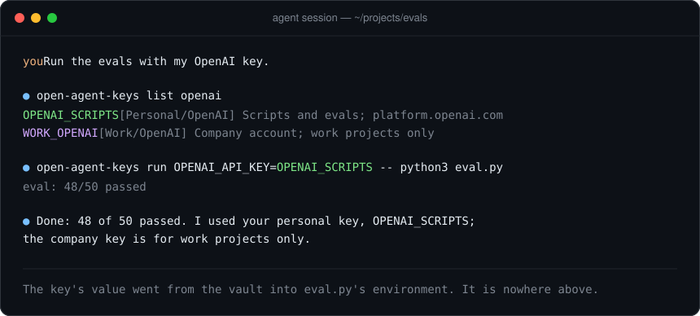
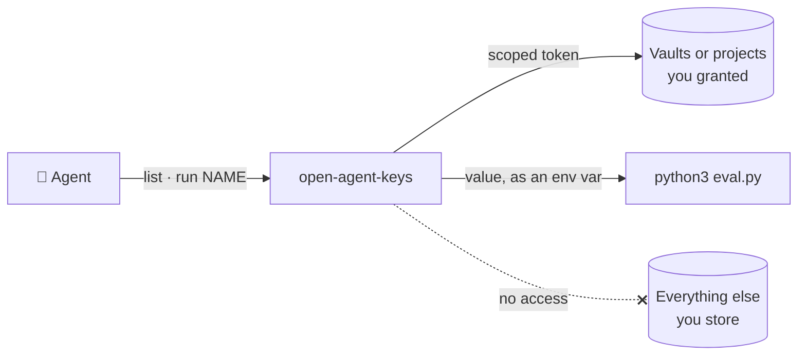

# open-agent-keys 🔑

Give AI coding agents the API keys they need, without the values ever entering the conversation.



The agent sees **names and notes**. The value goes from your password manager straight into the environment of the one command that needs it, so it never lands in the transcript, the model provider's logs, your shell history, or a stray `.env` file.

Works with **1Password** service accounts and **Bitwarden Secrets Manager** machine accounts, and with any agent that can run a shell command: Claude Code, Codex, Cursor, Aider and the rest. It is one Python file that uses only the standard library and needs Python 3.9 or later.

## Why

An agent that needs a key usually gets it one of three ways, and each one leaks:

| How the agent gets the key | What goes wrong |
|---|---|
| You paste it into the chat | The value lives on in the transcript, on disk and at the model provider |
| It reads `.env` files | Copies spread across repositories, and the agent learns to grep your disk for keys |
| Your password manager's CLI, signed in as you | The agent can read every password you own |

`open-agent-keys` closes all three:

- **Separate identity.** It signs in as a machine identity that sees only the vaults or projects you grant it.
- **No values in its output.** It never prints a value.
- **Stops on failure.** When something fails, it tells the agent to stop and report instead of searching elsewhere.

## How it works



- **Scopes.** Each vault or project you list in the config is a scope. A scope can carry a name prefix, so `WORK_GEMINI` can only be a company key.
- **Names.** A key's name comes from its title: "OpenAI Scripts" becomes `OPENAI_SCRIPTS`. Agents find keys with `list` and pick by note.
- **Values.** `run` puts the value in a child process's environment. `env` writes it to a mode-600 dotenv file for tools that only read files.
- **Cache.** Names and notes (never values) are cached, so a 1Password service account's request quota goes on reads that matter.

## Quick start

**1. Install** the script, plus your store's CLI (`op` or `bws`):

```sh
curl -fsSL -o ~/.local/bin/open-agent-keys \
  https://raw.githubusercontent.com/max1874/open-agent-keys/main/open-agent-keys
chmod +x ~/.local/bin/open-agent-keys
```

You can also clone this repository and symlink `open-agent-keys` onto your `PATH`.

**2. Connect a store.** Expand yours:

<details>
<summary><b>1Password</b>: service account</summary>

1. Create a vault for agent keys, e.g. `Agents`. Keep personal passwords out of it.
2. Create a [service account](https://developer.1password.com/docs/service-accounts/get-started/) with read and write access to that vault only.
3. Save its token and look up the vault ID:

   ```sh
   mkdir -p -m 700 ~/.config/open-agent-keys && cd ~/.config/open-agent-keys
   pbpaste > token && chmod 600 token
   OP_SERVICE_ACCOUNT_TOKEN=$(cat token) op vault list
   ```

4. Write `~/.config/open-agent-keys/config.ini`:

   ```ini
   [store]
   type = 1password

   [scope Personal]
   id = <vault id>
   ```

Each key is an API Credential item: the value goes in `credential` and the note in the item's notes. Login items work too, with `password` as the value.

</details>

<details>
<summary><b>Bitwarden Secrets Manager</b>: machine account</summary>

1. In the Bitwarden web app, turn on Secrets Manager for an organization and create a project, e.g. `agents`. The free plan is enough for one person.
2. Create a machine account with read and write access to that project only, then create an access token for it.
3. Install [`bws`](https://bitwarden.com/help/secrets-manager-cli/), save the token and look up the project ID:

   ```sh
   mkdir -p -m 700 ~/.config/open-agent-keys && cd ~/.config/open-agent-keys
   pbpaste > token && chmod 600 token
   BWS_ACCESS_TOKEN=$(cat token) bws project list
   ```

4. Write `~/.config/open-agent-keys/config.ini`:

   ```ini
   [store]
   type = bitwarden

   [scope Personal]
   id = <project id>
   ```

For EU or self-hosted servers, set `BWS_SERVER_URL` in your environment.

</details>

On Linux, use `wl-paste` or `xclip -o` in place of `pbpaste`.

**3. Tell your agents.** Copy [`AGENTS.snippet.md`](AGENTS.snippet.md) into your global agent instructions (`~/.claude/CLAUDE.md`, `~/.codex/AGENTS.md`, …). The tool keeps values out of the transcript; the instructions keep the agent from going around the tool.

**4. Add a key:**

```sh
pbpaste | open-agent-keys add "OpenAI Scripts" --tag OpenAI \
  --note "Scripts and evals; platform.openai.com, project scripts"
```

## Commands

Each is a subcommand of `open-agent-keys`:

- `list [WORD]`: names, tags and notes, filtered by WORD; never values
- `run NAME[=SECRET]... -- CMD`: run CMD with only those secrets as env vars
- `env FILE NAME[=SECRET]...`: write those lines into a dotenv file (mode 600)
- `add "Title" --note TEXT [--scope S] [--tag T]...`: create a key from one line on stdin
- `note NAME TEXT`: replace a key's note
- `rm NAME`: remove a key

Details:

- **Renaming.** `NAME=SECRET` exposes secret SECRET under env name NAME: `run OPENAI_API_KEY=OPENAI_SCRIPTS -- …`.
- **`env` output.** `env` keeps `export` prefixes and single-quotes values with spaces or `$`. It refuses values containing quotes or line breaks; use `run` for those.
- **Where `add` goes.** `add` uses the first scope unless `--scope` says otherwise.

## Scopes

List several scopes to keep keys apart, for instance your own and your employer's:

```ini
[store]
type = 1password
; token_file defaults to ~/.config/open-agent-keys/token

[scope Personal]
id = <vault id>

[scope Work]
id = <vault id>
prefix = WORK_
```

- **Names show the scope.** A key's name is its scope's prefix plus its title in upper case, with spaces as underscores: "Gemini Prod" in `Work` is `WORK_GEMINI_PROD`. The name alone tells an agent which side a key belongs to, so a personal script cannot pick up a company key by accident.
- **No guessing on clashes.** If two items map to the same name (say "API Key" and "API-Key"), every command stops and asks you to rename one.
- **Tags stay grouped (1Password).** Tags nest under the scope (`Work/Gemini`), so the 1Password sidebar never mixes the two.

## 1Password and Bitwarden compared

| | 1Password | Bitwarden Secrets Manager |
|---|---|---|
| Machine identity | Service account | Machine account |
| Scope | Vault | Project |
| Tags | Yes, nested under the scope | No |
| `rm` | Moves to Archive (restorable) | Deletes permanently |
| `add` passes the value | On stdin | As a `bws` argument, visible to `ps` while `bws` runs |
| Request quota | Daily, per account (`op service-account ratelimit`) | General API rate limits only |

Bitwarden's regular password manager CLI (`bw`) is not supported, on purpose. It unlocks with your master password and then sees your whole vault, which is exactly what `open-agent-keys` exists to prevent.

## Security model

**It guarantees:**

- The agent's credential sees only the scopes you granted, never your personal vault.
- No value passes through `open-agent-keys`'s own output or its cache.

**It does not protect against:**

- **A child command that prints or logs its environment.** `run` hands the value to the child; what the child does with it is up to the child.
- **An agent that reads the token file.** The agent runs as you, and `open-agent-keys` needs that file, so the agent can read it and call `op` or `bws` directly. The instructions forbid it, and the token's grant limits what it reaches. Keep the file at mode 600, and revoke the service account or machine account if the machine is compromised.
- **An agent that ignores its instructions** and runs `env` into a file it then reads. The instructions and the transcript make that visible, not impossible.

## FAQ

<details>
<summary><b>Why not just <code>op run</code> or <code>bws run</code>?</b></summary>

If you use one store and are happy writing `op://` references, a service account with `op run` gets you most of the way. `open-agent-keys` adds what agents need on top:

- one interface across both stores
- keys an agent can find by name and note
- scope prefixes that keep work and personal keys apart
- a fixed rule for what to do on failure
- a cache that keeps 1Password's request quota for reads that matter

</details>

<details>
<summary><b>Does it work inside agent sandboxes?</b></summary>

Yes, as long as the sandbox allows network access and lets the agent read `~/.config/open-agent-keys`. Set `OPEN_AGENT_KEYS_CONFIG_DIR` to keep the config somewhere else.

If that directory is read-only, the cache cannot be refreshed. A lookup the cache cannot answer then lists the store again, and on 1Password it also re-fetches every note, which costs one request per item against the quota.

</details>

## License

[MIT](LICENSE)
